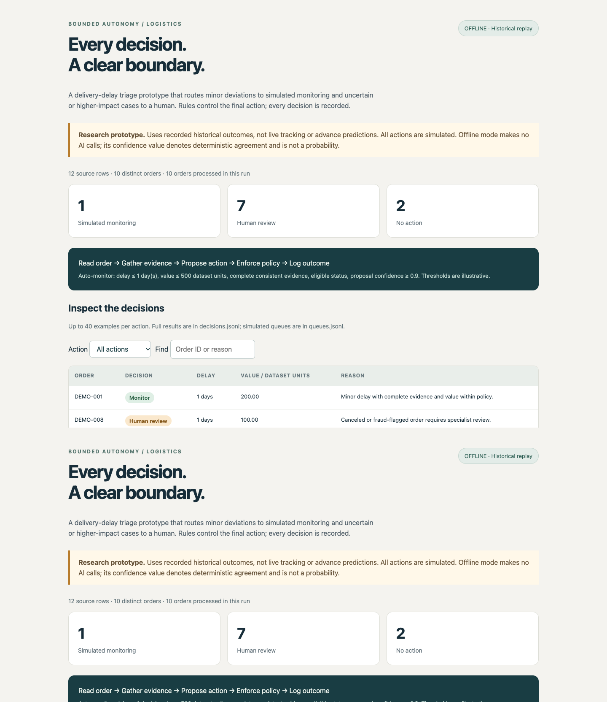

# Logistics Triage — Bounded Autonomy Prototype

A Python prototype for exploring which logistics decisions a program may handle automatically and which need human review. An AI model can gather evidence and propose an action; application code checks whether that action is permitted before recording the result.

The project has two separate demonstrations:

| Demonstration | Question | Data | Entry point |
|---|---|---|---|
| Historical order triage | How should this recorded order be categorised? | DataCo historical orders or ten fictional example orders | `triage.py` |
| Shipment investigation | Is there sufficient evidence of carrier collection to allow monitoring? | Five fictional, time-stamped shipment scenarios | `investigation.py` |

**Current status:** Both demonstrations have been exercised with a live model on synthetic examples. All **39 automated tests** passed with the optional SDK installed. All operational actions remain simulated: there are no real carrier connections, customer messages, shipment changes or scheduled rechecks. See [EVALUATION.md](EVALUATION.md) for the verification record.

**Policy update (9 November 2026):** Investigation policy `investigation-1.1` no longer rejects collection evidence because of age alone. CASE-STALE-SCAN now expects MONITOR when the other checks pass. Earlier live results used policy 1.0 and are preserved; policy 1.1 has automated, scripted and reviewed live-model verification on the three challenge cases.

## Run locally without API calls

From the repository folder, Python 3.9+ can run both demonstrations without third-party packages:

```sh
# Sort all ten fictional orders using fixed rules.
python3 triage.py --limit 0

# Investigate the original two fictional cases using scripted logic.
python3 investigation.py

# Run the three boundary cases, or all five cases.
python3 investigation.py --suite challenges
python3 investigation.py --suite all
```

Each command prints a local `report.html` path. Open that file in a browser to inspect the results. Offline triage and scripted investigation use ordinary code, not a live AI.

The original two investigation cases are:

- **CASE-RESOLVED:** A newer carrier collection scan resolves the initial discrepancy → MONITOR.
- **CASE-UNCONFIRMED:** Carrier evidence does not confirm collection; warehouse evidence says only PREPARED → ESCALATE.

The challenge suite covers an old collection scan, a scan for the wrong shipment, and a simulated carrier timeout. Under policy 1.1, the old valid collection scan permits MONITOR; the wrong-shipment and carrier-timeout cases still require ESCALATE.

## Run with a live model

Use Python 3.10+ for the optional SDK. Create an environment once, then install the pinned dependencies:

```sh
python3 -m venv .venv
source .venv/bin/activate
python -m pip install -r requirements-ai.txt
```

If the environment already exists, activate it with `source .venv/bin/activate`.

Configure your API key privately in the same Terminal session. On macOS's default zsh shell, run this line **exactly as written**:

```sh
read -s "OPENAI_API_KEY?Enter key: "
```

Press Return first. When `Enter key:` appears, paste the key and press Return again. The pasted key stays invisible. Do not insert the key into the command itself, paste it into chat, or commit it to Git. Then run:

```sh
export OPENAI_API_KEY
echo
read "OPENAI_MODEL?Enter an available API model ID: "
export OPENAI_MODEL
```

Choose a model available to your API account that supports function calling and structured output. Reviewed runs used the configured name `gpt-5-mini`; this is not a guarantee of account access or a recorded exact model version. Check API access and billing before making calls.

Choose one demonstration:

```sh
# Live AI triage of five fictional orders.
python triage.py --mode openai --limit 5

# Live investigation of the original two cases.
python investigation.py --mode openai

# Live investigation of the three challenge cases.
python investigation.py --mode openai --suite challenges
```

These commands make real model calls but still perform only simulated logistics actions. Triage caps live runs at 20 orders. Both adapters cap each case at six model turns. Those limits bound the demonstration size, not monetary cost. SDK trace uploads are disabled.

The environment variables last for the Terminal session. `.env.example` documents their names; the application does not load `.env` files automatically.

## How decisions are made

### Historical triage

```text
Group item rows into orders → propose a category → enforce policy → save decision and simulated queue entry
```

Offline mode generates the proposal with fixed rules. Live mode uses `sdk_agent.py`: the model must call `inspect_order` and `inspect_policy`, then return an action, confidence and explanation. The host checks that both tools ran and independently enforces the policy.

| Condition | Behaviour |
|---|---|
| Missing, invalid, contradictory or unrecognised evidence | ESCALATE |
| Canceled or fraud-flagged order | ESCALATE |
| Delayed order with hold or unresolved payment status | ESCALATE |
| Delay over 1 day or delayed-order value over 500 dataset monetary units | ESCALATE |
| Minor delay, complete consistent evidence, eligible status and matching proposal | MONITOR |
| Consistent non-delayed record and matching proposal | NO_ACTION |
| Invalid proposal, low confidence, required tools skipped, or per-order agent failure | ESCALATE |

These thresholds are illustrative, not validated business policy. Currency is unverified. Evidence completeness measures the presence of six fields; separate checks address inconsistencies. It does not establish source accuracy.

The live model's confidence is self-reported and uncalibrated. Offline confidence of 1.0 means agreement with the rules by construction, not certainty about business correctness. A model cannot override the code's limits and can request a more conservative escalation.

### Shipment investigation

```text
Initial discrepancy → choose evidence tools → inspect returned evidence → propose with citations → enforce policy → save simulated case entry
```

`investigation.py` provides scenarios, source adapters, evidence checks and reporting. `investigation_agent.py` provides the live model instructions and tool loop. The model can request carrier and warehouse evidence; scripted mode instead chooses steps through fixed logic.

A monitoring proposal must cite a qualifying carrier record actually retrieved during the investigation. Warehouse preparation does not prove collection. The host checks shipment identity, event times, availability by the scenario's decision time, chronology relative to the initial discrepancy, status and value limits. A source failure prevents automatic monitoring.

The model does not receive expected answers or fixture failure settings. The report records tool execution order and results, not hidden model reasoning. Multiple tools can be requested in one model turn.

See [INVESTIGATION.md](INVESTIGATION.md) for the full walkthrough and policy details.

## What has been tested

| Verification | Observed result |
|---|---|
| Full DataCo offline replay | 65,752 orders: 8,155 MONITOR, 30,748 ESCALATE, 26,849 NO_ACTION |
| Live triage on ten distinct synthetic orders (five-order and ten-order runs) | No recorded agent failures; ten-order run: 1 MONITOR, 7 ESCALATE, 2 NO_ACTION |
| Live investigation on two basic scenarios | 1 MONITOR, 1 ESCALATE; no recorded agent failures |
| Live investigation on three challenge scenarios (policy 1.0) | 3 ESCALATE; no recorded agent failures, one intentionally simulated source timeout |
| Live challenge scenarios (policy 1.1) | 1 MONITOR, 2 ESCALATE; no recorded agent failures, one intentional source timeout |
| Automated test suite | 39 passing tests with the optional SDK installed |

Run the tests without model calls:

```sh
python -m unittest -v
```

Tests cover data handling, policy boundaries, evidence citations and timestamps, source failures, reporting, usage logging and actual SDK tool loops with scripted models. Without optional dependencies, SDK tests are skipped.

**These results do not demonstrate an advantage over rules.** Under policy 1.0, the scripted and live investigators reached the same categories on the five examples. The three policy 1.1 challenge cases also produced matching scripted and live decisions. The immediate-escalation baseline in the audit is a comparison label: it represents sending a discrepancy straight to human review without investigating. It has less information than either investigator, so resolving more cases than that baseline does not establish AI superiority.

The scenarios have developer-defined expectations. Rule compliance is not proof of business correctness; review of the old-scan rule led to the policy 1.1 correction. Independent cases, domain-expert judgements and operational evaluation are still needed.

## Output files and usage records

Each run writes a separate directory under `runs/`:

| File | Historical triage | Investigation |
|---|---|---|
| `report.html` | Counts and up to 40 examples per category | Starting facts, tool results, proposal and final decision for each case |
| `decisions.jsonl` | One full audit record per order | — |
| `investigations.jsonl` | — | One full audit record per scenario |
| `queues.jsonl` | Simulated queue entries | Simulated case queue entries |
| `summary.json` | Input checksum, settings, decision counts, failures and usage totals | —; usage is stored per case in the audit |

New live records include the configured model name and SDK-reported request and token counts. Cached input tokens and reasoning output tokens are subsets, not additional tokens to add to the total. Configured model names may be aliases; exact resolved model versions are not captured. Earlier run files are unchanged and lack metadata introduced later.

Failed model runs may have unavailable usage even if some calls were billed. Reported totals are not a billing statement and may omit failures or retries. No monetary costs are calculated. A source timeout and an agent/provider error are recorded separately in investigation runs.

Files are local reports, not tamper-proof audit storage. Audit and queue writes are not transactional. A MONITOR entry does not schedule a later check, and an ESCALATE entry does not notify a person.



The screenshot and [saved demo report](docs/demo.html) show the original historical replay, not the investigation workflow.

## Historical data and privacy

The DataCo CSV contains **180,519 item rows representing 65,752 distinct orders**. The reader groups items by order and sums `Order Item Total`. Missing identifiers, duplicate items and conflicting attributes are checked rather than silently accepted.

To use your local copy:

```sh
python3 triage.py --csv "$HOME/Downloads/DataCoSupplyChainDataset.csv" --limit 200
# Use --limit 0 to replay all orders in offline mode.
```

Actual shipping duration and delivery labels are historical outcomes. This replay is not advance delay prediction or an evaluation of decisions made before those outcomes were known. The original timing field is not a verified customer-arrival timestamp. `Late_delivery_risk` is not used as a predictive input.

The investigation scenarios are separately invented decision-time snapshots. They do not add genuine tracking histories to the DataCo orders. Order value is only an illustrative impact proxy; neither demonstration establishes production criticality or real intervention costs.

Only allowlisted logistics fields are retained from the CSV. Customer names, email, passwords, addresses, coordinates and other personal fields are excluded from retained evidence and model inputs. Raw data, local run outputs, environments and secret files are ignored by Git. The public fixtures are synthetic.

## Next development priorities

- Define any future freshness requirements for current location or ETA separately from collection history.
- Validate decision rights, evidence requirements and thresholds with logistics practitioners.
- Compare the live investigator against a scripted investigator with equal access to evidence on independent cases.
- Evaluate unsafe actions, unnecessary escalations, explanation quality, time and API usage.
- Add operational integrations, durable case storage, human review and scheduled follow-up only after defining their requirements.

## Source and attribution

Constante, Fabian; Silva, Fernando; Pereira, António (2019), **DataCo SMART SUPPLY CHAIN FOR BIG DATA ANALYSIS**, Mendeley Data, V3. DOI: [10.17632/8gx2fvg2k6.3](https://doi.org/10.17632/8gx2fvg2k6.3). Dataset licence: CC BY 4.0, as stated on the [source page](https://data.mendeley.com/datasets/8gx2fvg2k6/3).

Transformations: selected non-customer columns, grouped item rows into orders, summed item totals, calculated recorded delay, applied illustrative rules and generated simulated queues. This independent project is not affiliated with or endorsed by the dataset contributors.
