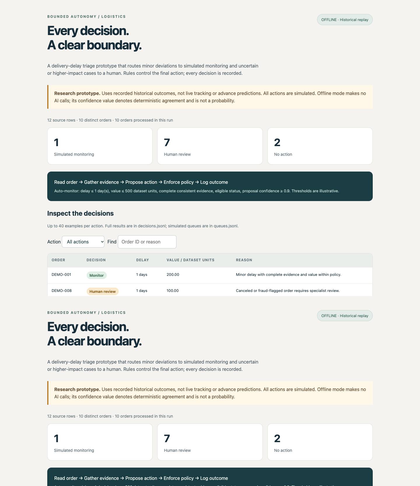
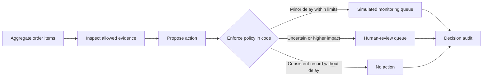

# Logistics Triage — Bounded Autonomy Prototype

A historical logistics replay that sends minor, low-value delays to a **simulated monitoring queue** and routes uncertain or higher-impact cases to **human review**. An optional OpenAI Agents SDK agent gathers evidence with tools and proposes an action; deterministic application rules enforce the final decision.

**Status:** Offline replay implemented. Optional live AI integration requires a locally configured API key and an available model. All actions are simulated. This is a research prototype, not a production logistics system.



## Try it in one minute

Python 3.9+ is sufficient for the offline demo. No API key or external packages are required.

```sh
python3 triage.py --limit 0
python3 -m unittest -v
```

The first command runs ten synthetic orders and prints the path to `report.html`. Open that file in a browser to inspect the decisions. Expected routes: **1 monitor, 7 human review, 2 no action**.

A pre-generated synthetic report is included at `docs/demo.html`; download and open it locally. See [EVALUATION.md](EVALUATION.md) for the full-dataset offline run and the difference between software verification and operational evaluation.

Use your locally downloaded DataCo file:

```sh
python3 triage.py --csv "$HOME/Downloads/DataCoSupplyChainDataset.csv" --limit 200
```

Replay every distinct order locally:

```sh
python3 triage.py --csv "$HOME/Downloads/DataCoSupplyChainDataset.csv" --limit 0
```

Each run creates a separate folder under `runs/` containing:

- `report.html`: a self-contained visual report with summary counts and up to 40 examples per action.
- `decisions.jsonl`: one audit record per processed order, including evidence, proposal, policy, final decision, and UTC timestamp.
- `queues.jsonl`: simulated monitoring or human-review queue entries; no-action records are also retained.
- `summary.json`: source checksum, input counts, sample seed, policy configuration, decision counts, and agent failures.

The log is written once per run. It is neither tamper-proof nor a production event store. Queue creation and audit writing are not transactional.

## Decision flow



Default demonstration policy:

| Condition | Final behaviour |
|---|---|
| Missing, invalid or conflicting evidence | Escalate |
| Canceled, fraud-flagged or unknown status | Escalate |
| Delayed order with a hold or unresolved payment status | Escalate |
| Recorded delay greater than 1 day | Escalate |
| Delayed order value greater than 500 dataset monetary units | Escalate |
| Minor delay, eligible status, value within limit, complete evidence, matching proposal | Simulate monitoring |
| Consistent record without delay, matching proposal | No action |
| Proposal confidence below 0.90, invalid proposal, skipped evidence tools, or agent failure | Escalate |

Thresholds are illustrative design choices, not Scania policy. Currency has not been verified. The system does not infer production impact, material criticality, or delay causes from order value.

## Confidence and authority

Evidence completeness is the fraction of six required fields available. Conflicting source rows and contradictory labels are checked separately. Completeness does not prove that the source is correct.

In **offline mode**, a deterministic simulator produces the proposal; no LLM runs. Its score of 1.0 denotes deterministic agreement with the policy, not a probability of business correctness. Offline proposal agreement is true by construction and is not an accuracy metric.

In **OpenAI mode**, the agent returns a self-reported confidence score. It is **uncalibrated**. A score above the threshold never authorises an action that violates the code-enforced rules. Calibration would require labelled, independent decisions and reliability analysis before production use.

The AI can recommend a more conservative escalation. It cannot authorise refunds, change shipments, contact customers, or bypass a rule. Agent failures are logged by exception type without storing potentially sensitive error messages.

## Optional: enable the OpenAI Agents SDK

Use Python 3.10+ for optional SDK dependencies. Create an isolated environment:

```sh
python3 -m venv .venv
source .venv/bin/activate
python -m pip install -r requirements-ai.txt
```

Create an API key in your OpenAI account and configure it **locally**, outside this repository. Do not paste a key into a chat or commit it. On macOS, the following reads the key without displaying it:

```sh
read -s "OPENAI_API_KEY?Paste API key locally, then press Enter: "
export OPENAI_API_KEY
echo
read "OPENAI_MODEL?Enter an available API model ID: "
export OPENAI_MODEL
python triage.py --mode openai --limit 5
```

Those `read` commands use macOS's default zsh shell. `.env.example` documents the variable names; this app does not automatically load `.env` files. Model calls may incur charges; check your API account's access and billing first. No particular model ID is hardcoded.

Start with the synthetic dataset. The live mode caps each run at 20 orders and each order at six SDK turns. These caps bound the demo size, not its monetary cost. SDK tracing uploads are disabled; local audit records are used instead.

The SDK agent calls `inspect_order` and `inspect_policy`, then returns a structured recommendation. The host verifies that both tools were called and applies the independent policy gate. Only allowlisted order fields are exposed. The live integration is optional and must be tested with a real model before claiming live-agent results.

Documentation: [OpenAI Agents SDK quickstart](https://developers.openai.com/api/docs/guides/agents/quickstart).

## Data interpretation and limitations

- The supplied DataCo v3 CSV contains **180,519 order-item rows and 65,752 distinct Order Id values**. Decisions must be made after grouping items by order. Order value is the sum of `Order Item Total`; repeated totals such as `Sales per customer` are not summed.
- `Days for shipping (real)` and `Delivery Status` are recorded historical outcomes. This prototype deliberately uses them for **retrospective outcome replay**, not advance delay prediction or live intervention. It does not estimate how a policy would have performed with only information available before the outcome.
- The timing field is not a verified customer-arrival timestamp. Its precise operational meaning needs validation against the source data dictionary. Use a live tracking snapshot and an explicit decision timestamp for a prospective system.
- `Late_delivery_risk` is not used as an input or treated as a model prediction. Outcome labels are used only for consistency checks within the retrospective replay.
- Existing completed orders are routed to hypothetical queues to demonstrate decision boundaries; monitoring them now has no operational value.
- Samples are selected with a seeded shuffle of distinct orders. They are reproducible for the same source file and seed, but are not a chronological holdout or a labelled effectiveness evaluation.
- Routing counts are not measures of prediction accuracy, workload saved, financial benefit, or decision quality. A domain expert should label a held-out set of scenarios; then measure unsafe auto-actions, appropriate escalations, automation coverage, confidence calibration, latency, and cost.
- Order value is only an illustrative impact proxy. The dataset lacks verified criticality, available alternatives, inventory state, production interruption risk, and the cost of intervention.
- Source items with conflicting attributes or duplicate/missing item identifiers are escalated. Missing order IDs become separate review cases rather than being merged.

## Privacy and publication

The source CSV remains outside the repository. The reader retains only order ID, item ID, item total, recorded and scheduled timing, delivery status, order status, and shipping mode. Names, addresses, email, customer passwords, customer IDs, coordinates, and product text are excluded from retained evidence and API inputs.

Raw data, local run outputs, environments, and secrets are ignored by Git. The bundled ten-order fixture is **synthetic**. Inspect the files being staged before publication; never force-add the original CSV or local run outputs.

## Tests and research extensions

The test suite checks aggregation, duplicate item detection, missing identifiers, invalid numbers, confidence boundaries, high-confidence unsafe recommendations, agent failures, source-field privacy, and report escaping. These tests validate software policy enforcement; they do not establish business effectiveness.

With optional dependencies installed, four additional tests run the **actual SDK tool loop with a scripted model**. They verify tool execution, structured outputs, refusal to accept skipped evidence tools, handling of a model failure, and enforcement against an unsafe recommendation. These use no network or credentials and do not test live model quality.

Next research steps: replace historical outcomes with time-correct snapshots, validate autonomy boundaries with a logistics expert, label independent test cases, calibrate confidence, compare an agent against a deterministic baseline, and use an authenticated review workflow with durable queues and transactional audit storage.

## Source and attribution

Constante, Fabian; Silva, Fernando; Pereira, António (2019), **DataCo SMART SUPPLY CHAIN FOR BIG DATA ANALYSIS**, Mendeley Data, V3. DOI: [10.17632/8gx2fvg2k6.3](https://doi.org/10.17632/8gx2fvg2k6.3). Source licence: **CC BY 4.0**, as stated on the [dataset page](https://data.mendeley.com/datasets/8gx2fvg2k6/3).

Transformations: selected non-customer columns, grouped item rows into orders, summed item totals, calculated recorded delay, applied illustrative rules, and generated simulated queues. This project is independent and is not affiliated with or endorsed by Scania or the dataset contributors.
